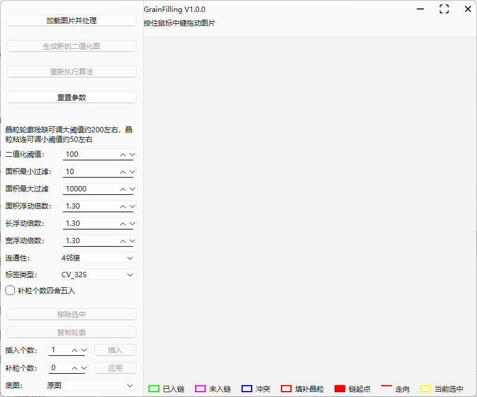
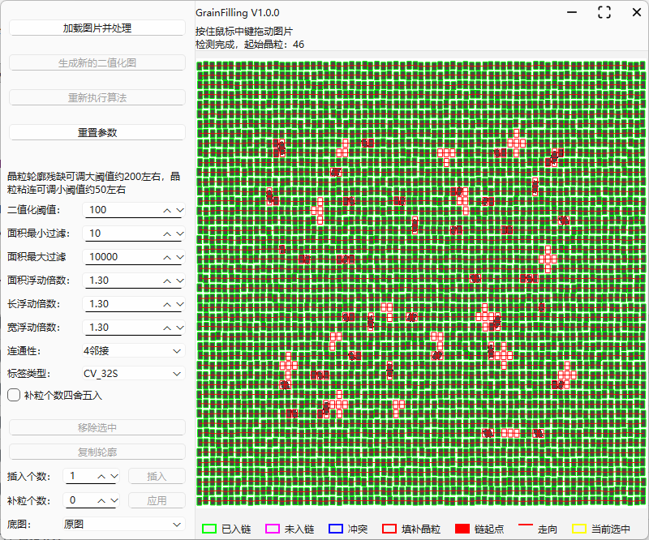
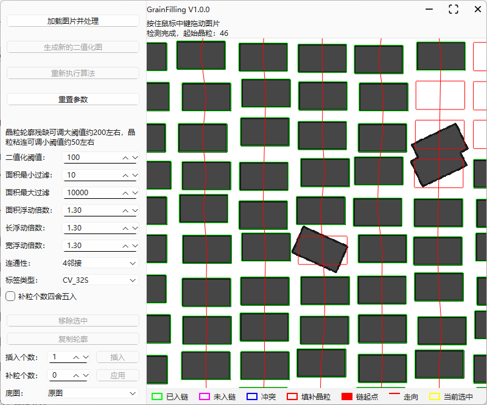
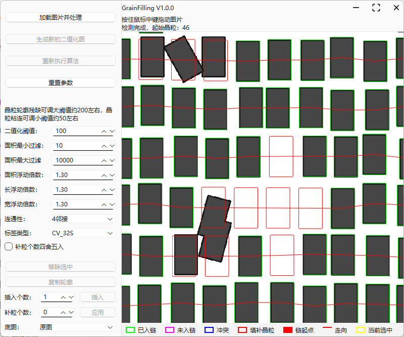
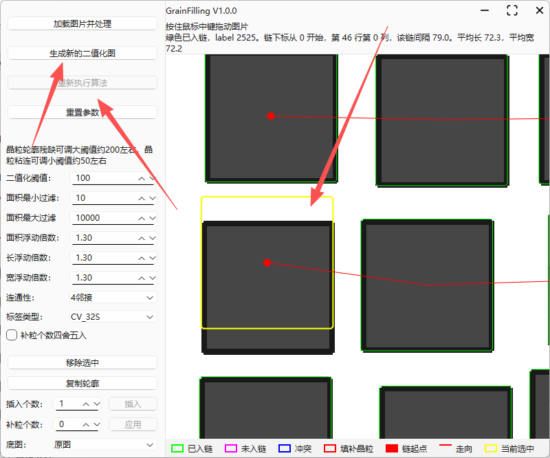
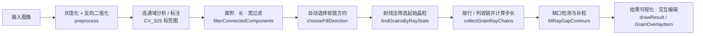

# GrainFilling（grain_fill_ui）

> 晶粒图像检测与缺口自动填补工具 —— 一套基于 OpenCV 检测流水线 + Qt Widgets 交互式可视化的桌面应用。


---

## 目录

- [项目简介](#项目简介)
- [功能特性](#功能特性)
- [界面预览](#界面预览)
- [算法原理](#算法原理)
- [交互操作](#交互操作)
- [参数说明](#参数说明)
- [结果颜色图例](#结果颜色图例)
- [目录结构](#目录结构)
- [技术栈](#技术栈)
- [环境要求](#环境要求)
- [构建与运行](#构建与运行)
- [配置与日志](#配置与日志)
- [错误码](#错误码)
- [常见问题](#常见问题)
- [许可证](#许可证)
- [作者与致谢](#作者与致谢)

---

## 项目简介

GrainFilling 面向晶粒（颗粒）显微图像的**检测与自动补全**场景。它实现了一条完整的图像处理流水线：

> **灰度化与反向二值化 → 连通域分析 → 面积/长/宽过滤 → 射线法定位起始晶粒 → 按行/列收链 → 缺口检测与自动补粒**

在此基础上，软件提供 Qt Widgets 可视化界面，支持实时调节算法参数、直观查看收链与补粒结果，并通过鼠标直接编辑晶粒轮廓，形成 **「检测 → 人工修正 → 重新生成二值图 → 重跑算法」** 的闭环工作流。

**典型应用场景：**

- 金相 / 材料显微图像的晶粒识别、计数与缺失补全；
- 工业检测中规则排列颗粒（如芯片、电极、阵列单元）的漏检补全与缺陷分析；
- 科研与算法验证中的参数调优、结果可视化与掩膜导出。

---

## 功能特性

- **一键检测**：加载图片即完成预处理、连通域过滤、起始晶粒定位、行/列收链与缺口补全全流程；
- **射线收链算法**：从晶粒质心沿主方向发射窄带射线，自动将晶粒归入有序的行链或列链，并识别相邻晶粒之间的缺失个体；
- **智能补粒**：以链内最小质心步长为基准自动计算缺口补粒数量（支持四舍五入），并复用最近边界晶粒的轮廓生成待补轮廓；
- **参数实时调优**：二值化阈值、面积过滤、浮动倍数、连通性等参数边调边看，无需重启；
- **交互式编辑**：点选 / 多选轮廓，支持移除（软删除）、复制轮廓、在两颗相邻晶粒间插入补粒、局部修改补粒个数、拖拽移动轮廓；
- **二值图闭环**：编辑完成后可按当前轮廓一键重新生成二值图，再驱动算法重跑，保证人工修正不丢失；
- **专业可视化**：绿 / 紫 / 蓝 / 红 / 黄多色区分晶粒状态与链走向，支持 0.01×–50× 缩放与平移；
- **工程化基础**：spdlog 分级轮转日志、TOML 配置文件、CMake Presets + vcpkg 依赖管理。

---

## 界面预览

| 软件主界面 | 算法结果总览 |
| :-: | :-: |
|  |  |

| 倾斜场景细节处理 | 粘连场景细节处理 | 自由编辑轮廓后重跑 |
| :-: | :-: | :-: |
|  |  |  |

---

## 算法原理

完整检测流水线如下：



### 1. 图像预处理（`preprocess`）

将输入图像（支持 1 / 3 / 4 通道）转为灰度图，再以用户设定的阈值做**反向二值化**（`THRESH_BINARY_INV`），目标晶粒在二值图中为白色（255）、背景为黑色。二值化阈值是控制检测效果最直接的参数：

- 阈值调大 → 晶粒内部更容易完整保留，可缓解**轮廓残缺**；
- 阈值调小 → 相邻晶粒更容易被二值化分离，可缓解**粘连**。

### 2. 连通域过滤（`filterConnectedComponents`）

对二值图做连通域标注（默认 4 邻接，`CV_32S` 标签图），随后分两轮过滤：

1. **硬阈值**：保留面积落在 `[minArea, maxArea]` 区间的连通域；
2. **均值浮动区间**：以通过硬阈值的晶粒平均面积 / 长 / 宽为基准，保留落在 `[均值 / 浮动倍数, 均值 × 浮动倍数]` 区间的晶粒（面积、长、宽浮动倍数默认均为 1.3）。

> 注意：当晶粒整体较小时，绝对区间很窄（例如平均面积为 8、倍数 1.3 时保留范围约为 6~10），容易误剔正常晶粒，此时可适当放大浮动倍数。

### 3. 起始晶粒定位（`chooseFillDirection` + `findGrainsByRayState`）

根据晶粒平均长宽**自动选择收链方向**：

- 平均长 ≥ 平均宽 → 按**行**从左到右收链（`kRayLeft`）；
- 平均宽 > 平均长 → 按**列**从上到下收链（`kRayTop`）。

随后从每个晶粒的质心沿主方向发射窄带射线（默认半宽 1 像素，即 3 像素厚的带状采样）：射线能够到达图像边界、且途中未被其他晶粒阻挡的晶粒被选为**起始晶粒（锚点）**，并按坐标排序。

### 4. 收链与步长计算（`collectGrainRayChains`）

从每个起始晶粒出发，沿主方向用同样宽度 3 像素的射线带搜索下一颗晶粒，收集为**有序晶粒链**（一行或一列）。每条链的**步长**取链内相邻晶粒质心距离的最小值。过程中：

- 射线碰到**已在其他链中**的晶粒 → 该晶粒记为**冲突**，当前链在此截止；
- 检测完成后仍 **enable 且未入链** 的晶粒记为**未参与**（紫色）。

### 5. 缺口检测与补粒（`fillRayGapContours`）

对链上相邻两颗晶粒之间的缺口：

1. 计算补粒个数：`n = floor(距离 / 步长) - 1`，勾选「补粒个数四舍五入」后改为 `round(距离 / 步长) - 1`；
2. 在两端晶粒质心之间**线性插值**出 `n` 个补粒质心；
3. 每颗补粒的轮廓取**距离其最近**的边界晶粒轮廓，按整数偏移平移到对应质心处。

### 6. 结果绘制与交互（`drawResult` / `GrainOverlayItem`）

算法结果以多色轮廓叠加在图像上；所有轮廓同时写入两张标签图（晶粒标签图与补粒标签图），供界面**像素级点选**，实现轮廓编辑与状态联动。

---

## 交互操作

| 操作 | 说明 |
| --- | --- |
| 鼠标滚轮 | 以光标所在位置为中心缩放（自适应比例的 0.01× ~ 50×） |
| 鼠标中键拖拽 | 平移图像 |
| 鼠标左键单击 | 选中晶粒 / 补粒轮廓（按住 `Ctrl` 可多选 / 取消选择） |
| 鼠标左键拖拽 | 移动选中的晶粒或复制的轮廓（不足 1 像素的位移自动累积，不会丢失） |
| 加载图片并处理 | 选择图片（PNG / JPEG / BMP / TIFF），完成预处理并首次检测，图像自适应显示 |
| 生成新的二值化图 | 按当前阈值重新生成二值图；若此前编辑过轮廓，则按当前轮廓重新导出二值图 |
| 重新执行算法 | 使用当前二值图与参数重新检测，保持当前缩放与平移不变 |
| 重置参数 | 所有算法参数恢复默认值 |
| 移除选中 | 软删除选中的晶粒（`enable=false`）或移除复制的轮廓 |
| 复制轮廓 | 复制选中的绿色（已入链）晶粒轮廓，作为自由放置的轮廓 |
| 插入 | 在**同一条链上相邻的两颗绿色晶粒**之间，按「插入个数」生成补粒轮廓 |
| 应用 | 修改当前选中补粒缺口（红色）的补粒个数 |
| 底图 | 在「原图」与「二值图」之间切换显示底图 |

**推荐工作流：**

```
加载图片并处理
   ↓
调整阈值 / 过滤参数 → 生成新的二值化图 → 重新执行算法（直到结果满意）
   ↓
交互编辑：移除误检 / 复制轮廓 / 插入补粒 / 拖拽微调 / 局部修改补粒个数
   ↓
编辑完成后：生成新的二值化图 → 重新执行算法（人工修正参与下一轮检测）
```

---

## 参数说明

| 参数 | 默认值 | 说明 |
| --- | --- | --- |
| 二值化阈值 `thresh` | `100` | 反向二值化阈值。阈值偏大缓解轮廓残缺，偏小缓解晶粒粘连 |
| 面积最小过滤 `minArea` | `10` | 连通域最小面积（像素），低于该值的噪声直接剔除 |
| 面积最大过滤 `maxArea` | `10000` | 连通域最大面积（像素），高于该值的连通域直接剔除 |
| 面积浮动倍数 `areaRatio` | `1.3` | 保留面积区间 `[均值/倍数, 均值×倍数]`。晶粒较小时可适当放大 |
| 长浮动倍数 `lengthRatio` | `1.3` | 保留长度区间 `[均值/倍数, 均值×倍数]` |
| 宽浮动倍数 `widthRatio` | `1.3` | 保留宽度区间 `[均值/倍数, 均值×倍数]` |
| 连通性 `connectivity` | `4` | 连通域邻接方式：`4` = 4 邻接（上下左右），`8` = 8 邻接（含对角线） |
| 标签类型 `labelType` | `CV_32S` | 标签图数据类型，像素值为晶粒 `labelId`，0 为背景 |
| 补粒个数四舍五入 `roundFillCount` | `false` | `false`：`floor(距离/步长)-1`；`true`：`round(距离/步长)-1` |

---

## 结果颜色图例

| 颜色 | 含义 |
| --- | --- |
| <span style="color:green">■</span> 绿色 | 已入链晶粒（enable 且已进入晶粒链，非冲突） |
| <span style="color:purple">■</span> 紫色 | 未入链晶粒（enable 但未参与任何链） |
| <span style="color:blue">■</span> 蓝色 | 冲突晶粒（射线碰到、但已在其他链中的晶粒） |
| <span style="color:red">■</span> 红色 | 增补晶粒（填补轮廓） / 链起点（锚点） / 链走向连线 |
| <span style="color:orange">■</span> 黄色 | 当前选中的轮廓 |

---

## 目录结构

```
grain_fill_ui/
├── CMakeLists.txt              # 构建脚本（Qt6 + OpenCV + spdlog + toml++）
├── CMake Presets.json          # VS2022 x64 Debug/Release 预设（内置 vcpkg 工具链）
├── vcpkg.json                  # vcpkg manifest（依赖清单）
├── resources.rc / app.ico      # Windows 资源与图标
├── images/                     # 示例输入图像
├── docs/
│   └── screenshots/            # 界面与效果截图（README 引用）
└── src/
    ├── main.cpp                # 程序入口
    ├── widget.cpp / .h / .ui   # 主窗口：交互逻辑与界面布局
    ├── DetectSession.cpp / .h  # 单次检测会话（图像、参数、结果、编辑状态）
    ├── DetectParamForm.cpp / .h# 参数控件与 DetectParam 的读写绑定
    ├── alg/                    # 算法核心（与 UI 解耦，纯 OpenCV）
    │   ├── GrainFilling.*      # 检测流水线：预处理 / 连通域过滤 / 收链 / 补粒
    │   ├── GrainDraw.*         # 结果绘制、轮廓叠加、掩膜导出
    │   └── ImageUtil.*         # 图像读写（支持中文路径）、Mat ⇄ QImage
    ├── components/             # 自绘控件
    │   ├── HWindow.*           # 无边框窗口（Win32 原生消息）
    │   ├── HButton.*           # 自绘状态按钮
    │   ├── ImageView.*         # 图像视图：缩放 / 平移 / 选中 / 拖拽
    │   ├── GrainOverlayItem.*  # 轮廓叠加图元与像素级点选
    │   └── ContourLegend.*     # 颜色图例
    ├── config/                 # TOML 配置（Config.h 通用配置基类）
    ├── log/                    # spdlog 日志封装（分级 + 大小轮转）
    └── res/                    # 图标 / Logo（qrc 资源）
```

---

## 技术栈

| 组件 | 版本 | 用途 |
| --- | --- | --- |
| Qt Widgets | 6.5+ | 桌面图形界面 |
| OpenCV | 4.12+ | 图像处理：二值化、连通域、轮廓、绘制 |
| spdlog | 1.x | 分级日志与文件轮转 |
| toml++ | 3.x | TOML 配置解析 |
| CMake | 3.19+ | 构建系统 |
| vcpkg | manifest 模式 | 第三方依赖管理 |
| C++ | 20 | 语言标准 |

---

## 环境要求

- **操作系统**：Windows 10 / 11 x64（当前主要支持平台，无边框窗口依赖 Win32 原生消息）
- **编译器**：Visual Studio 2022（含「使用 C++ 的桌面开发」工作负载）
- **CMake**：3.19 或更高
- **Qt**：6.5 或更高（MSVC x64）
- **vcpkg**：已安装并配置 `VCPKG_ROOT` 环境变量

---

## 构建与运行

### 方式一：使用 CMake Presets（推荐）

```powershell
# 1. 克隆仓库
git clone https://github.com/<your-name>/grain_fill_ui.git
cd grain_fill_ui

# 2. 安装依赖（vcpkg manifest 模式，自动安装 opencv / spdlog / tomlplusplus）
vcpkg install

# 3. 配置并构建 Release
cmake --preset release
cmake --build build-release --config Release

# 4. 运行
.\build-release\Release\GrainFilling.exe
```

### 方式二：手动配置

```powershell
cmake -B build -DCMAKE_TOOLCHAIN_FILE="$env:VCPKG_ROOT\scripts\buildsystems\vcpkg.cmake"
cmake --build build --config Release
```

> 说明：CMake 已集成 `qt_generate_deploy_app_script`，可一键生成部署脚本（`windeployqt`），方便将程序连同 Qt 运行库一起分发。

---

## 配置与日志

### 配置文件

将 `src/config/app.example.toml` 复制为 `app.toml` 后按需修改：

```toml
# 服务（预留字段）
[server]
host = "0.0.0.0"
port = 3077
threads = 2

# 日志
[logging]
level = "info"            # trace / debug / info / warn / error / critical / off
max_file_size_mb = 100    # 单日志文件大小上限
max_files = 20            # 日志文件保留数量
```

### 日志

基于 spdlog 实现，支持分级输出与按大小轮转，避免长期运行占满磁盘；日志库初始化失败时自动降级为简易日志（`easyLog`），保证关键错误可排查。

---

## 错误码

算法接口统一以**非 0 返回码**报告失败原因，负值错误码含义如下：

| 错误码 | 含义 |
| --- | --- |
| `-1` | 输入图像为空（或绘制输入无效） |
| `-2` | 图像通道数不是 1 / 3 / 4 |
| `-3` | 二值图为空 |
| `-4` | 二值图类型不是 `CV_8UC1` |
| `-5` | 没有通过过滤的有效连通域 |
| `-6` | 标签图无效或类型不是 `CV_32S` |
| `-7` | 像素坐标越界 |
| `-8` | 自动选择收链方向失败（平均长宽非有限正数） |
| `-9` | 射线筛选位无效（低 4 位为 0） |
| `-10` | 没有匹配射线状态的起始晶粒 |
| `-11` | 晶粒下标越界 |
| `-12` | 插值点数小于 1 |
| `-13` | 收链方向非法（不是行方向 / 列方向） |
| `-14` | 目标图像尺寸无效 |

---

## 常见问题

**Q：晶粒轮廓残缺怎么办？**
将二值化阈值调大（约 200 左右），让晶粒内部更完整地保留为白色。

**Q：晶粒粘连分不开怎么办？**
将二值化阈值调小（约 50 左右），让相邻晶粒更早被二值化分离。

**Q：小晶粒被误剔除？**
适当放大面积 / 长 / 宽浮动倍数。晶粒较小时均值浮动区间非常窄，1.3 倍可能只差 1~2 个像素。

**Q：修改了阈值但「重新执行算法」按钮是灰的？**
阈值变化后必须先「生成新的二值化图」，算法才会基于新二值图重跑，这是有意设计的操作约束，防止误用旧二值图。

---

## 许可证

本仓库目前**未附带 LICENSE 文件**。如计划公开开源，建议先补充合适的许可证（例如 MIT）；其中无边框窗口组件 `HWindow` 遵循 [MIT 协议](https://github.com/woshi-xs/HWindow)。

---

## 作者与致谢

- **作者**：黄小松（woshi-xs）
- **邮箱**：[woshixs123@gmail.com](mailto:woshixs123@gmail.com)
- **GitHub**：[https://github.com/woshi-xs](https://github.com/woshi-xs)
- **致谢**：[HWindow](https://github.com/woshi-xs/HWindow) —— 轻量无边框窗口组件（MIT）

---

*文档维护：建议随版本发布同步更新，保持「界面预览」「参数说明」「错误码」与源码一致。*
